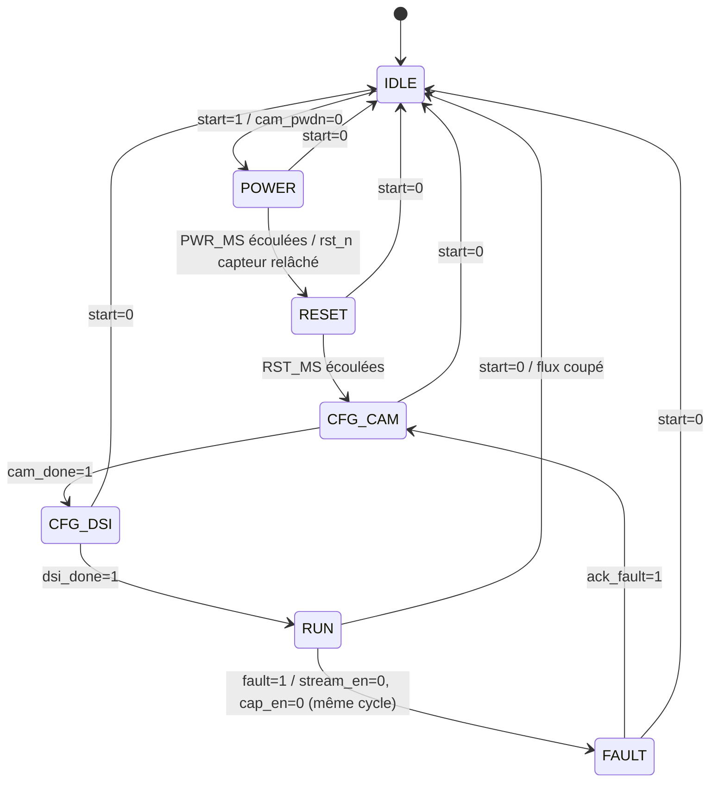

# FSM de supervision (machine de Mealy)

Sorties de Mealy (dépendent de l'état **et** des entrées) :

| Sortie | Équation |
|--------|----------|
| cam_pwdn | `1` si IDLE et start=0 |
| cam_rst_n | `0` si IDLE, POWER ou start=0 ; sinon `1` |
| cap_en = stream_en | `1` si RUN et fault=0 et start=1 (retombent dans le cycle où fault monte) |
| led_err | `1` si FAULT, ou RUN avec fault=1 |
